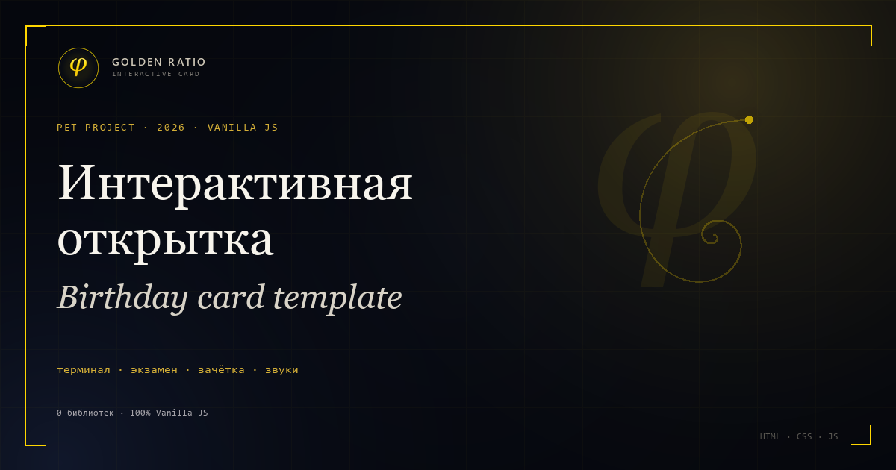

# Interactive Birthday Card — Vanilla JS template

Демо-проект: интерактивная открытка-поздравление на чистом **HTML, CSS и JavaScript**. Без React, jQuery, сборщиков и единой внешней библиотеки.

Внутри — шутливый «экзамен», терминал, зачётная книжка, Canvas-конфетти, звуки, котик и несколько пасхалок. Проект задуман как шаблон: тексты, имена, палитру и музыку можно заменить, сохранив всю механику.



> **Автор:** [RoBiN19666](https://github.com/RoBiN19666) · [Telegram](https://t.me/robin19666) · [MIT](LICENSE)
>
> Сделано с помощью инструмента **DeepSeek**.

---

## ✨ Что внутри

- ✈️ **Telegram-прелоадер** — золотой самолётик, который ждёт первого жеста, если браузер блокирует автоплей.
- 🖥️ **Терминал на входе** — `npm install happy-birthday` с эффектом печатной машинки.
- 🌌 **Hero-экран** — фиксированная золотая спираль Фибоначчи на SVG, фоновые частицы и крупная типографика.
- 🧪 **Экзаменационный билет** — счётчик багов, кнопка «Запушить баги» и шутливая ошибка 403.
- 🏃 **Кнопка «Не нажимать»** — оборот на 360°, матричный распад справа налево и подпись «Ты чево наделал...».
- 📖 **Зачётная книжка** — 3D-раскрытие, анимированная оценка «ЗАЧЕТ», роспись и убегающая кнопка «Незачет».
- 💛 **Искренний блок** — крупный текст Playfair Display и котик на слове «мурррчания»: на десктопе мурчит зацикленно при наведении, на телефоне — 10 секунд по тапу.
- 🎵 **Lo-fi плеер** — музыка стартует после терминала, зациклена до открытия зачётки, приглушается во время мурчания; на десктопе громкость регулируется встроенным ползунком.
- 🔊 **Звуковые эффекты** — ветер, включение терминала, печать поверх включения, открытие и закрытие зачётки, ручка, мурчание и CRT-выключение. У каждого эффекта есть тайминг и плавное затухание.
- 🎉 **Canvas-конфетти** — золотые и чёрные частицы, без сторонних библиотек.
- 🖥️ **Финал** — консоль с командами, CRT-выключение и растворение финальной фразы в темноте.
- 🪟 **Кастомные модальные окна** — focus trap, закрытие по `Escape`, блокировка скролла.
- 📱 **Mobile-first** — оптимизировано под WebView Telegram, без горизонтального скролла.
- ♿ **Доступность** — семантическая разметка, `aria-live`, видимый фокус, поддержка `prefers-reduced-motion`.
- 🕵️ **Пасхалки** — стилизованные сообщения в консоли и комментарии в HTML.

---

## 🧱 Стек

| | |
|---|---|
| **HTML5** | семантическая разметка, SVG, аудио |
| **CSS3** | тёмная тема, glassmorphism, 3D-трансформации, CRT, адаптив |
| **JavaScript** | Vanilla JS, Canvas 2D, Web Audio через HTMLAudioElement |
| **Шрифты** | Google Fonts: Montserrat, Playfair Display, Caveat |
| **Зависимости** | 0 |
| **Сборка** | Не требуется |
| **Инструмент** | DeepSeek (AI-assisted development) |

---

## 📁 Структура

```text
.
├── index.html      # Разметка, спираль, зачётка, финальная консоль
├── style.css       # Тёмная тема, glassmorphism, 3D, CRT, адаптив
├── script.js       # Терминал, Canvas, зачётка, звук, финальная сцена
├── logo-mark.png     # Логотип в шапке и favicon
├── og-preview-v2.png # Превью 1200×630 для Telegram и Open Graph
├── .nojekyll       # Отключает Jekyll на GitHub Pages
├── sounds/         # Все аудиофайлы проекта
│   ├── wind.mp3
│   ├── boot.mp3
│   ├── typing.mp3
│   ├── lofi.mp3
│   ├── book-open.mp3
│   ├── book-close.mp3
│   ├── pen.mp3
│   ├── purr.mp3
│   └── crt-off.mp3
├── LICENSE         # MIT
├── .gitignore
└── README.md
```

Все имена, тексты и даты в демо — примеры. Реальных персональных данных в проекте нет.

---

## 🚀 Локальный запуск

Сайт статический, но для корректной работы шрифтов и аудио лучше поднять локальный сервер.

**Python:**

```bash
python -m http.server 8000
```

Открой [http://localhost:8000](http://localhost:8000).

**Node.js:**

```bash
npx serve .
```

**VS Code:** установи расширение **Live Server** и открой `index.html` через **Open with Live Server**.

---

## 🌐 Деплой на GitHub Pages

Сайт уже опубликован по адресу:

`https://robin19666.github.io/greeting-card/`

Чтобы поднять копию:

1. Создай **публичный** репозиторий.
2. Запушь проект в ветку `main`.
3. Открой **Settings → Pages**.
4. Выбери **Deploy from a branch → main → / (root)** и сохрани.
5. Через минуту сайт будет доступен по адресу `https://ЛОГИН.github.io/ИМЯ-РЕПОЗИТОРИЯ/`.

Файл `.nojekyll` уже в корне — GitHub не будет пытаться обрабатывать статику через Jekyll.

---

## 🎨 Как адаптировать шаблон

| Что менять | Где |
|---|---|
| Имя получателя, заголовок, подзаголовок | `index.html`, секция `.hero` |
| Текст экзаменационного билета | `index.html`, `#examQuote` и `#examSub` |
| Текст искреннего блока | `index.html`, `.sincere-card__body` |
| Поля зачётки: предмет, преподаватель, студент | `index.html`, `.gradebook__fields` |
| Подпись в зачётке | `index.html`, `.gradebook__signature-text` |
| Финальная фраза | `index.html`, `#finaleQuote` |
| Строки финальной консоли | `script.js`, `finaleLines` |
| Сообщения в консоли браузера | `script.js`, блок «Консольные пасхалки» |
| Палитра | `style.css`, переменные `:root` |
| Музыка и SFX | папка `sounds/`, объект `soundFiles` в `script.js` |
| Превью для Telegram | `og-preview-v2.png` и мета-теги в `<head>` |

Все эффекты, тайминги, звуковая логика и адаптив при этом сохраняются.

---

## 💬 Превью для Telegram

В `index.html` прописаны `og:title`, `og:description` и абсолютный `og:image`:

```html
<meta property="og:url" content="https://robin19666.github.io/greeting-card/">
<meta property="og:image" content="https://robin19666.github.io/greeting-card/og-preview-v2.png">
<meta property="og:image:width" content="1200">
<meta property="og:image:height" content="630">
<meta property="og:image:alt" content="Интерактивная открытка-поздравление — демо-проект">
<meta name="twitter:card" content="summary_large_image">
```

Если репозиторий переименовать или сменить домен, обнови `og:url`, `og:image`, `twitter:image` и `canonical`.

Telegram кэширует превью. Если после изменений показывается старая карточка, отправь ссылку с `?v=2` или прогони её через `@WebpageBot`.

---

## 🔄 Обновление

```bash
git add .
git commit -m "feat: update birthday card"
git push
```

GitHub Pages пересоберёт сайт автоматически после пуша в `main`. Если обновление не появилось через пару минут, проверь **Settings → Pages** и **Actions → pages build and deployment**.

---

## 👤 Автор

**RoBiN19666**

- GitHub: [github.com/RoBiN19666](https://github.com/RoBiN19666)
- Telegram: [@robin19666](https://t.me/robin19666)
- Демо: [robin19666.github.io/greeting-card](https://robin19666.github.io/greeting-card/)

Проект создан с помощью инструмента **DeepSeek**.

---

## 📄 Лицензия

Проект распространяется по лицензии **MIT**. Можно использовать как основу для собственной открытки, менять тексты, имена, цвета, звуки и структуру. См. [LICENSE](LICENSE).

```
MIT License · Copyright (c) 2026 RoBiN19666
```
